<div align="center">



<p>
  <a href="https://kutluhangil.github.io/Cinemania/"></a>
  
  
  
</p>

<p><em>A responsive movie discovery platform built with vanilla JavaScript on the TMDB API.<br>
Browse trending and upcoming films, search the catalogue and keep your own library.</em></p>


</div>


## Features

| | |
|---|---|
| **Daily trending hero** | The trending film of the day, front and centre. |
| **Weekly trends and upcoming** | This week's trends and this month's releases. |
| **Catalogue** | Keyword search with a year filter, server-side pagination and load more. |
| **Movie modal** | Details and the trailer in a modal. |
| **My Library** | Add and remove films, kept in localStorage. |
| **Themes** | Dark and light, remembered between visits. |
| **Polish** | A global loader, scroll-to-top, retina images, and W3C-valid HTML and CSS. |
| **Mobile first** | Layouts at 320, 768 and 1280 px. |

<table>
  <tr>
    <td width="20%"></td>
    <td width="40%"></td>
    <td width="40%"></td>
  </tr>
</table>


## Türkçe özet

**Cinemania**, TMDB API üzerinde vanilla JavaScript ile ekip olarak geliştirdiğimiz duyarlı bir film keşif platformu. Günün trend filmi, haftalık trendler, bu ayın vizyondakileri, yıl filtreli katalog araması, fragmanlı film detayı ve kişisel kütüphane içeriyor; karanlık ve aydınlık tema var. GoIT Full Stack programında grup projesi olarak hazırlandı; footer ve ekip modalı benim sorumluluğumdaydı. Türkçe, Lehçe ve Rumence README'ler depoda ayrıca duruyor.


<h2 id="team-members">👥 Geliştirici Ekip & Sorumluluklar</h2>

<ul>
  <li>
    <strong>Çiğdem Ergal</strong> — Team Lead<br />
    <em>Sorumluluk:</em> Header & Liderlik<br />
    <a href="https://github.com/CigdemErgal" target="_blank">
      
    </a>
    <a href="https://www.linkedin.com/in/%C3%A7i%C4%9Fdem-ergal/" target="_blank">
      
    </a>
  </li>

  <li>
    <strong>Halenur Gürel</strong> — Scrum Master<br />
    <em>Sorumluluk:</em> Hero & Scrum Yönetimi<br />
    <a href="https://github.com/halenurgurel" target="_blank">
      
    </a>
    <a href="https://www.linkedin.com/in/halenurgurel/" target="_blank">
      
    </a>
  </li>

  <li>
    <strong>Ali Hamza Çakmak</strong> — Developer<br />
    <em>Sorumluluk:</em> Modals (Detail & Trailer)<br />
    <a href="https://github.com/MRMARUL" target="_blank">
      
    </a>
    <a href="https://www.linkedin.com/in/ali-hamza-%C3%A7akmak-8112553a8/" target="_blank">
      
    </a>
  </li>

  <li>
    <strong>Aslıhan Erdal</strong> — Developer<br />
    <em>Sorumluluk:</em> Upcoming This Month<br />
    <a href="https://github.com/ERDLL0" target="_blank">
      
    </a>
    <a href="https://www.linkedin.com/in/aslihan-erdal/" target="_blank">
      
    </a>
  </li>

  <li>
    <strong>Burak Gökay</strong> — Developer<br />
    <em>Sorumluluk:</em> Weekly Trends<br />
    <a href="https://github.com/bgokay007-tech" target="_blank">
      
    </a>
    <a href="https://www.linkedin.com/in/burak-g%C3%B6kay-196b66348/" target="_blank">
      
    </a>
  </li>

  <li>
    <strong>Kerem Yıldırım</strong> — Developer<br />
    <em>Sorumluluk:</em> Catalog<br />
    <a href="https://github.com/keremyldrm61" target="_blank">
      
    </a>
    <a href="https://www.linkedin.com/in/kerem-y%C4%B1ld%C4%B1r%C4%B1m-0053a5191/" target="_blank">
      
    </a>
  </li>

  <li>
    <strong>Yusuf Soylu</strong> — Developer<br />
    <em>Sorumluluk:</em> Pagination<br />
    <a href="https://github.com/soylu1092" target="_blank">
      
    </a>
    <a href="https://www.linkedin.com/in/yusuf-soylu-525236306/" target="_blank">
      
    </a>
  </li>

  <li>
    <strong>Nur Seda Ağgünlü</strong> — Developer<br />
    <em>Sorumluluk:</em> My Library<br />
    <a href="https://github.com/nursedaaggunlu" target="_blank">
      
    </a>
    <a href="https://www.linkedin.com/in/nur-seda-aggunlu/" target="_blank">
      
    </a>
  </li>

  <li>
    <strong>Zehra Yazıcı</strong> — Developer<br />
    <em>Sorumluluk:</em> My Library Hero<br />
    <a href="https://github.com/zehrayazici" target="_blank">
      
    </a>
    <a href="https://www.linkedin.com/in/zehrayazici/" target="_blank">
      
    </a>
  </li>

  <li>
    <strong>Kutluhan Gül</strong> — Developer<br />
    <em>Sorumluluk:</em> Footer & Team Modal<br />
    <a href="https://github.com/kutluhangil" target="_blank">
      
    </a>
    <a href="https://www.linkedin.com/in/kutluhangil/" target="_blank">
      
    </a>
  </li>
</ul>


## Development

```sh
npm install
npm run dev      # http://localhost:5173
npm run build
```

<div align="center">
<br>
<a href="https://github.com/kutluhangil"></a>
<sub>Fork of <a href="https://github.com/january-javaScript-project/Cinemania">january-javaScript-project/Cinemania</a> · created for educational purposes in the GoIT Full Stack programme.</sub>
</div>
